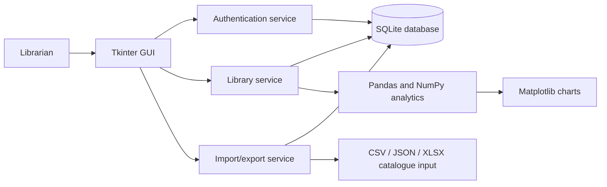
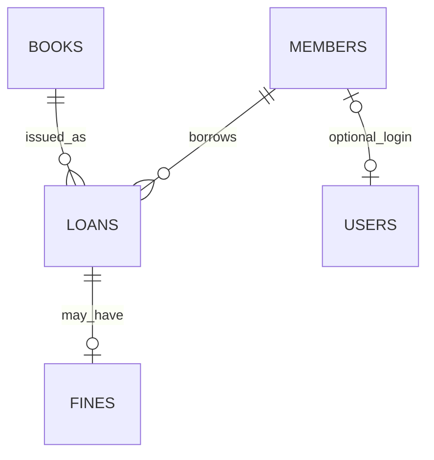

# Smart Library Management System — Project Report Notes

## Abstract

The Smart Library Management System is a desktop application for maintaining
a small library catalogue and its lending records. It provides librarian
authentication, book and member management, inventory-aware issuing and
returns, due-date and fine tracking, file import/export, and record-based
analytics. Python's Tkinter provides the interface and SQLite stores data
locally. Database constraints and transactional service operations help keep
inventory and loan records consistent.

## Objectives

- Replace manual book, member, and lending registers with a local database.
- Track catalogue copies separately from each individual loan.
- Prevent issuing unavailable books and processing returns twice.
- Calculate overdue charges using configurable settings.
- Import and export catalogues and operational reports.
- Demonstrate Python programming concepts in a testable application.

## Scope and assumptions

This implementation is a single-computer librarian desktop application; it
does not synchronize multiple branches or provide member self-service login.
The default loan period is 14 days and default fine rate is 5.00 units per
late day. These values are editable in the application settings. Catalogue
imports use ISBN as the record key. An existing ISBN updates descriptive
fields, never its copy quantities. Sample catalogue rows in `data/` are
fictional demonstration data and are not loaded automatically.

## Methodology

1. Initialize database tables and constraints automatically.
2. Create the first librarian account and authenticate with a PBKDF2 password
   hash.
3. Validate user input in the service layer before database writes.
4. Perform related loan and inventory changes in one SQLite transaction.
5. Export records and calculate analytics only from stored data.
6. Run automated tests on schema rules and core lending workflows.

## Architecture diagram

## Database relationships

`users` stores librarian credentials. `books` stores one record per ISBN and
its inventory counts. Each `loans` row connects one member to one book. A
returned late loan may have one `fines` row. `settings` stores the configured
loan period and daily fee.

## Python syllabus mapping

| Topic | Example in the project |
|---|---|
| Data types, conditions, loops, functions | service operations and import loops |
| Lists, tuples, sets, dictionaries | records, column definitions, row validation |
| Lambda functions and sorting/search | catalogue and report ordering/filtering |
| CSV, JSON, directories | streaming import and report export |
| Exceptions and logging | `utils/exceptions.py` and `utils/logging_config.py` |
| Classes, objects, inheritance | `models/entities.py`, `Librarian`/`Member` from `User` |
| Encapsulation and polymorphism | service methods expose controlled data operations |
| Regular expressions | email, phone, and ISBN format validation |
| NumPy and Pandas | borrowing summaries and inventory arrays |
| Matplotlib | popular-book chart export |
| Tkinter and events | login, notebook tabs, buttons, and selection callbacks |
| SQLite and transactions | database package and issue/return services |

## Modules

- **Authentication:** first-run librarian creation and password verification.
- **Books and members:** validated CRUD and search operations.
- **Circulation:** atomic inventory adjustment, loan tracking, returns, and
  fines.
- **Files:** CSV/JSON exports and streaming CSV/Excel catalogue imports.
- **Analytics:** borrowing summaries, overdue counts, and chart export.
- **GUI:** dashboard, catalogue/member forms, circulation, fines, reports, and
  settings.

## Advantages and limitations

**Advantages:** local SQLite setup, no default credentials, copy counts are
protected by constraints, common tasks are available from one GUI, and core
business rules can be tested independently.

**Limitations:** one local database, librarian-only GUI access, no multi-user
network synchronization or backups built into the application, and demand
prediction is not included. Fine rates are expressed as generic currency
units.

## Screenshot checklist

Capture these screens for a project presentation after creating demo records:

1. First-run librarian setup or login screen (do not expose the password).
2. Dashboard with actual records.
3. Book search and catalogue table.
4. Member table and validation feedback.
5. Active loan and return flow.
6. Overdue loan and fine/payment table.
7. Import result showing accepted/rejected row counts.
8. Analytics text and exported chart.
9. Settings tab.

## Demonstration script

1. Launch the app and create a librarian account.
2. Import `data/sample_books.csv`.
3. Add a sample member from the Members tab.
4. Issue an available sample title to that member.
5. Show the reduced available-copy count and active loan.
6. Return the loan; demonstrate the due-date/fine behavior.
7. Export a book or loan report as CSV and save a borrowing chart.
8. Open settings and explain the loan duration and daily rate.
9. Run the test suite in a terminal to show automated verification.

## Viva questions and short answers

**Why use SQLite?** It is built into Python, uses a local file, and is suitable
for a small desktop project.

**Why store total and available copies?** Total quantity represents owned
copies; available quantity changes as loans are issued and returned.

**Why use a transaction for issue and return?** It makes the loan and inventory
updates succeed or roll back together.

**How are passwords stored?** As salted PBKDF2-HMAC-SHA256 hashes, not as
plaintext.

**How is a fine calculated?** Late calendar days multiplied by the configured
daily rate; active overdue loans show an estimate and returns record the final
amount.

**How are duplicate imports handled?** Repeated ISBNs within a file are
rejected. A previously stored ISBN updates descriptive fields only, preserving
inventory.

**What does Pandas do here?** It groups actual loan records for popular-book,
category, and monthly summaries.

**What could be added later?** Member self-service, backup/restore, a web
client, and a tested demand-prediction model.
